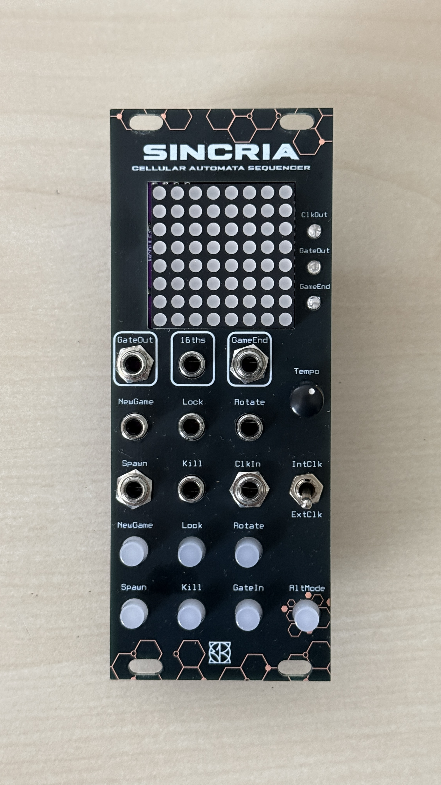
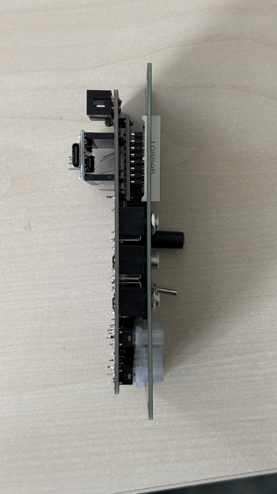

# SINCRIA

### Let a living pattern write the rhythm.

**An open-source Eurorack cellular-automaton sequencer.** An 8 × 8 LED world evolves with Conway-style rules while a 64-step scan turns living cells into rhythmic events. Freeze, rotate, spawn and remove cells to move between repeating structures and evolving patterns.

 

[User guide](docs/USER_GUIDE.md) · [Build and modify](docs/DEVELOPMENT.md) · [Firmware](firmware/SINCRIA_Rev2_OK/SINCRIA_Rev2_OK.ino) · [Schematics](hardware/schematics/README.md) · [Contribute](CONTRIBUTING.md)

## A sequencer you can reshape

The display is an 8 × 8 grid. A live cell survives with two or three live neighbours; a dead cell is born with three. The scan reads columns left to right, rows bottom to top. After the end of a scan the generation can evolve; empty or stationary states can cause a new random world. Horizontal neighbours wrap, vertical edges do not: this implementation is not a fully toroidal grid.

Use the internal **60–200 BPM** clock, with sixteenth-note stepping, or advance the scan with an external clock. CLOCK/16ths emits an event for each step; the live-cell/gate path marks living cells; GAME END marks regeneration. LED matrix highlighting inverts the currently scanned cell for visibility.

| Control | Normal action | Alternate action |
| --- | --- | --- |
| NewGame | Randomise the world | Restart scan |
| Lock | Toggle generation evolution lock | Shift cells left, with wrap |
| Rotate | Rotate the grid 90° clockwise | Shift rows up, with wrap |
| Spawn | Add a random live cell | With external clock, write live cells along the scan while held |
| Kill | Remove a random live cell | With external clock, erase cells along the scan while held |
| AltMode | Hold about 200 ms to toggle alternate controls | Alt LED indicates state |

The firmware's pulse target is 10 ms, serviced in the main loop. These are trigger-like events, not gate lengths tied to the full step. The [user guide](docs/USER_GUIDE.md) explains the exact behavior and current limitations.

## Firmware and hardware baseline

Published sketch: **SINCRIA_Rev2_OK**, internally dated **4 August 2025** — the latest local SINCRIA source found for this publication. There is no embedded semantic version. The more recent PCB assets are labelled **REV2.2 (September 2026)**; the sketch name does not by itself prove compatibility with every board revision.

The code targets an Arduino Nano-style AVR pin layout and a MAX7219 8 × 8 display through **LedControl 1.0.6**. A reproducible **Nano ATmega328P / 16 MHz** build is documented in the [development guide](docs/DEVELOPMENT.md). Confirm the installed MCU and the corrected schematic before uploading to a physical board.

**Corrected schematics, editable CAD and a revision-matched hardware release are awaiting maintainer upload** in [hardware/schematics](hardware/schematics/README.md). Photos show the assembled product; they are not a substitute for verified wiring or electrical limits.

## Get started

Download/extract this repository, install **LedControl 1.0.6** from Arduino Library Manager, and open `firmware/SINCRIA_Rev2_OK/SINCRIA_Rev2_OK.ino`. Build for the confirmed Nano processor; Old Bootloader is selected only if your Nano needs it. Start with internal clock, turn Tempo, generate a new world and try Lock/Rotate. Use external pulses held stable for more than 5 ms for the initial clock test, within your board's verified electrical limits.

This publication preserves the original source. It does not add MIDI, pitch CV, pattern storage, a new GateIn handler or a clock reset input. See [known limitations](docs/USER_GUIDE.md#known-limitations) before modifying or extending it.

## Open-source and contributions

Complete editable Arduino source is included. Use [the function map, pin map and build instructions](docs/DEVELOPMENT.md) to change the automaton rules, traversal, clock or controls. Share firmware changes and measured hardware results through pull requests.

Original project materials: **GNU GPL-3.0**. [License](LICENSE) · [Notice](NOTICE.md) · [Contribute](CONTRIBUTING.md). Other E103 projects: [faun](https://github.com/E103-designs/faun) · [ALTERIA](https://github.com/E103-designs/ALTERIA).
