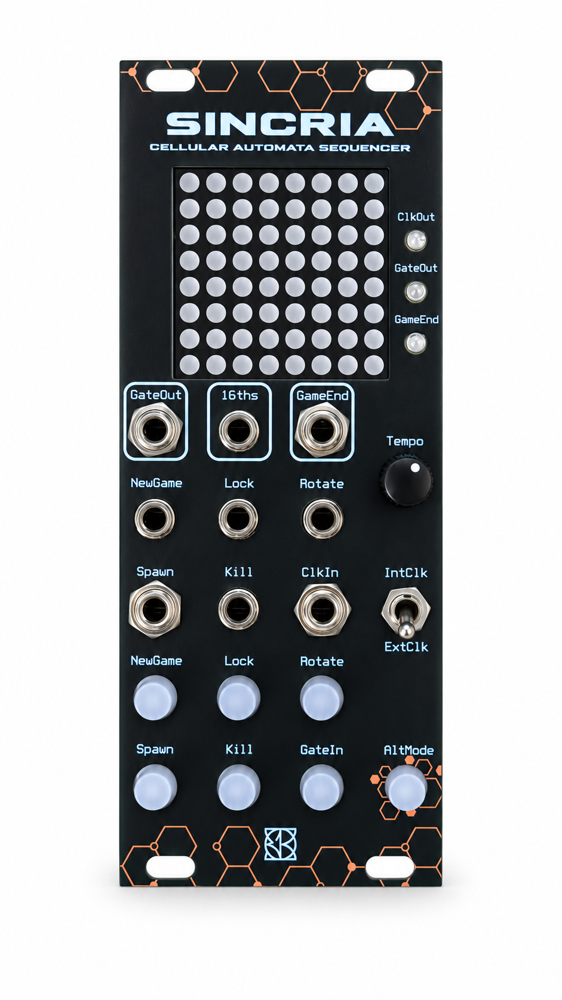
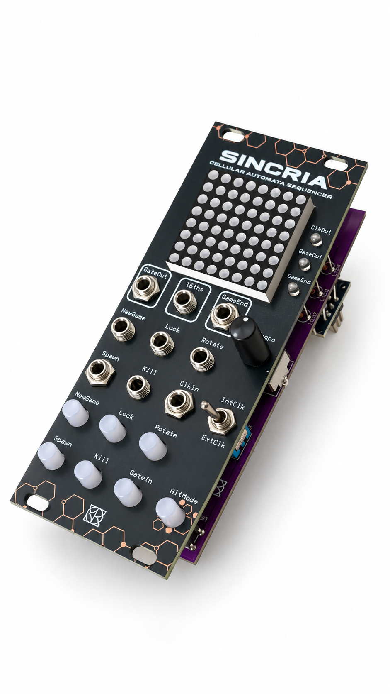
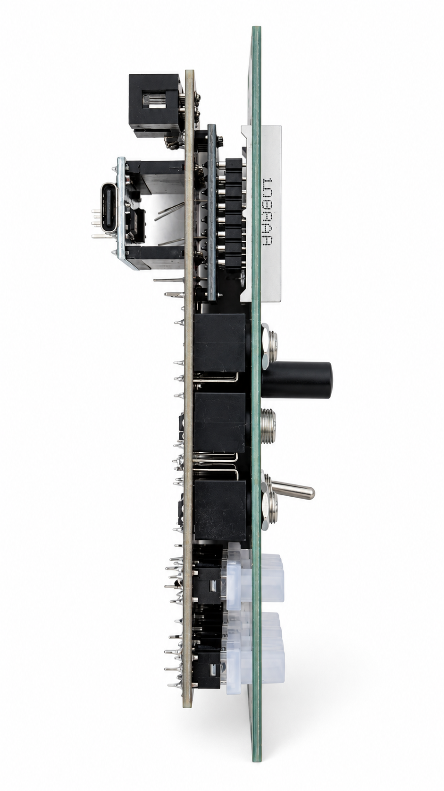

# SINCRIA

### Evolving rhythms. Pixel-sized worlds.

**A Eurorack cellular-automaton sequencer with an arcade side.** Build rhythmic patterns from an evolving 8 × 8 LED world, then reboot into **EUROBOY** to play Snake or draw an interactive Game of Life colony on the same module.

 

[Sequencer guide](docs/USER_GUIDE.md) · [EUROBOY games](docs/EUROBOY.md) · [Firmware](firmware/SINCRIA_Scansione_Righe/SINCRIA_Scansione_Righe.ino) · [Build and modify](docs/DEVELOPMENT.md) · [Schematics](hardware/schematics/README.md)

## One module, three modes

| Mode | What it does | Start-up controls |
| --- | --- | --- |
| **SINCRIA sequencer** | A 64-step scan turns living cells into rhythmic triggers | Power on normally |
| **EUROBOY: Snake** | Steer, collect food and fill the 8 × 8 world | Hold **ALT MODE + SPAWN** during power-on or reset |
| **EUROBOY: Life** | Draw a colony, animate it, pause and reshape it | Hold **ALT MODE + KILL** during power-on or reset |

Release the buttons after the game entry animation. To return to the sequencer, reboot without a game combination. Holding ALT MODE + SPAWN + KILL also selects the sequencer.

## Let the pattern write the rhythm

SINCRIA scans the physical display from left to right, one row at a time from top to bottom. The inverted cursor marks the **next step**. CLOCK emits a pulse on every step, LIVE/GATE responds to living cells and END marks automatic regeneration.

- Internal clock: **30–300 BPM**, four steps per beat, or an external clock.
- Conway **B3/S23** evolution after a complete scan; the musical grid wraps across its columns.
- **NEW GAME** creates a new world; **LOCK** freezes evolution and regeneration.
- **ROTATE**, **SPAWN** and **KILL** reshape the pattern while it runs.
- Hold **ALT MODE** to access scan reset, grid shifts and live-cell painting with external clock.
- Empty patterns and short repeating cycles can regenerate into new material; LOCK keeps a chosen pattern in place.

[Read the sequencer controls and timing details](docs/USER_GUIDE.md).

## EUROBOY: the arcade inside your rack

**Snake** turns the LED matrix into a tiny playfield. Steer with the panel buttons, set the speed with the clock knob and wrap across the edges. Fill all 64 cells to win; press SPAWN after the end screen to restart.

**Interactive Life** gives you an editable pixel colony. Move the cursor, add cells with NEW GAME, erase with ROTATE and switch between INT to evolve and EXT to pause. Unlike the musical grid, this mode wraps across **both axes** and keeps still lifes and oscillators running without random regeneration.

| Direction | Panel control |
| --- | --- |
| Up | LOCK |
| Down | KILL |
| Left | SPAWN |
| Right | GATE IN |

Musical outputs remain low throughout both games. Use the module's normal power arrangement; USB powers the Nano but does not necessarily power the complete display/control circuit. [Full arcade guide](docs/EUROBOY.md).

## Install the firmware

Current firmware: **Handheld Games, 28 October 2026**, sketch `SINCRIA_Scansione_Righe`.

1. Download and extract the repository.
2. Install **LedControl 1.0.6** in Arduino Library Manager.
3. Open `firmware/SINCRIA_Scansione_Righe/SINCRIA_Scansione_Righe.ino`.
4. Select **Arduino Nano → ATmega328P**, using Old Bootloader when required by the installed Nano.
5. Upload, then start normally for sequencing or hold a game combination at reset.

The default input profile is **1**, for the inverting transistor inputs used by Rev2.2/Rev2.3. Profile 0 supports the earlier active-high wiring. Check the [pin map and board profile](docs/DEVELOPMENT.md) before flashing a different revision. The older `SINCRIA_Rev2_OK` sketch remains available for historical reference.

## Open source

Full Arduino source, regression tests, development instructions and circuit schematic are included. Change the automaton, scan order, timing or games using the [development guide](docs/DEVELOPMENT.md). [Validation results](docs/PUBLICATION_CHECKS.md) describe software coverage and resource use.

Side view

**GNU GPL-3.0.** [License](LICENSE) · [Attribution](NOTICE.md) · [Contribute](CONTRIBUTING.md).

Other E103 projects: [faun](https://github.com/E103-designs/faun) · [ALTERIA](https://github.com/E103-designs/ALTERIA) · [euroTrack](https://github.com/E103-designs/euroTrack).
